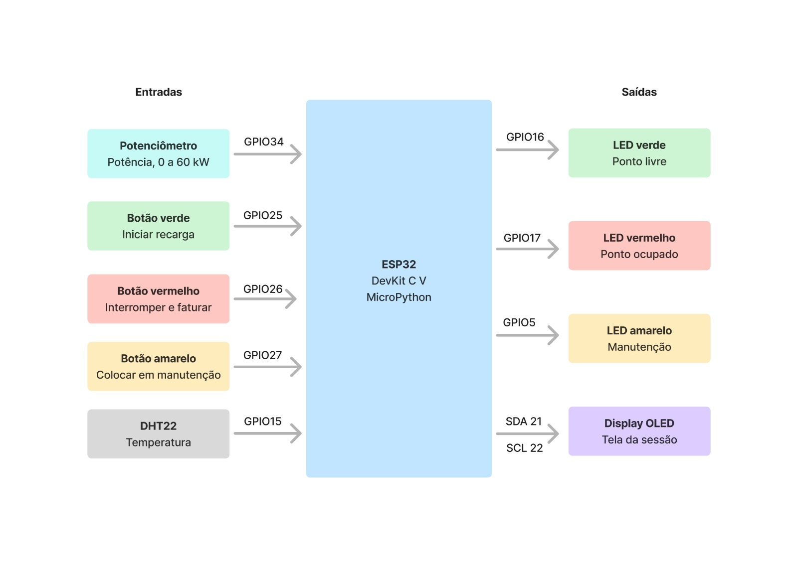
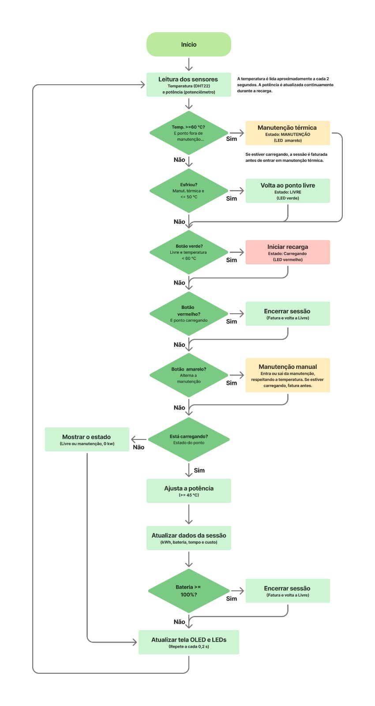
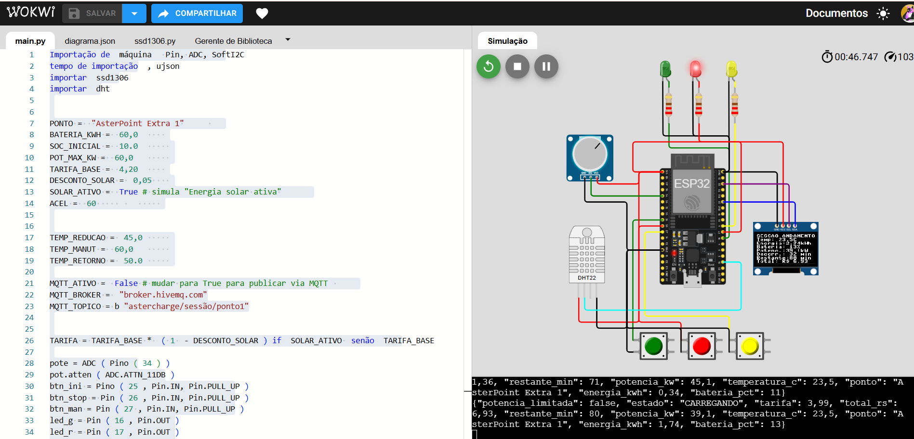

# AsterCharge: Recarga de Carros Elétricos com Monitoramento e Proteção Inteligente

**Vídeo técnico:** [Link do youtube ]

**Simulação no Wokwi:** https://wokwi.com/projects/477874260497817601

## Equipe

- Andrey Crence Fernandes (RM 573840)
- Giulliana Maistro Brasolin (RM 569381)
- Mikaella Mirela Dos Santos Lucindo (RM 573775)
- Lara Dos Santos Cândido Alves (RM 573827)
- Lucas Parkin Devito (RM 573251)

**Turma:** 1CCA

## 1. Visão geral

O AsterCharge é um projeto de estação inteligente para recarregar carros elétricos. A ideia é aproveitar a energia solar disponível para oferecer descontos e acompanhar a recarga, incentivando o uso de energia limpa.

O projeto tem três partes principais:

- **Aplicativo AsterCharge:** permite que o usuário veja os pontos de recarga no mapa, consulte o desconto de 5% com energia solar e acompanhe a recarga. O operador pode acompanhar o funcionamento dos carregadores, gerenciar os pontos e redistribuir a demanda nos horários de pico.

- **Preço da recarga (Sprint 3):** utiliza uma simulação no Wokwi com ESP32 e MicroPython. Um sensor de luz representa a energia solar, um potenciômetro representa a demanda de energia e um botão representa os horários de pico.

- **Sessão de recarga (Sprint 4):** utiliza outra simulação no Wokwi com ESP32 e MicroPython. Ela simula uma recarga completa, calcula a energia utilizada, o nível da bateria, o tempo restante e o custo. Também possui um sistema de proteção contra o superaquecimento.

## 2. Arquitetura final e integração dos sistemas

### 2.1 Como as partes se conectam

Nesta etapa, o aplicativo e os protótipos ainda não estão conectados 100%. Cada parte funciona separadamente, mas todas seguem as mesmas regras, como o preço de R$ 3,99 por kWh com desconto solar e os estados do carregador: livre, ocupado ou em manutenção.

O protótipo da recarga envia informações a cada 2 segundos em um formato chamado JSON. Entre os dados enviados estão o estado do carregador, a potência, a energia utilizada, o nível da bateria, a temperatura, a tarifa e o valor total.

O código também possui suporte ao MQTT, um recurso usado para enviar mensagens entre dispositivos conectados. Ele está configurado para o HiveMQ, mas fica desligado por padrão.

Assim, o protótipo já está preparado para uma futura conexão com o aplicativo.

### 2.2 Componentes utilizados

| Componente | Pino | Função |
|---|---|---|
| ESP32 | Não se aplica | Recebe os dados dos sensores e controla o sistema |
| Potenciômetro | GPIO 34 | Simula a potência da recarga, de 0 a 60 kW |
| Sensor DHT22 | GPIO 15 | Mede a temperatura |
| Botão verde | GPIO 25 | Inicia a recarga |
| Botão vermelho | GPIO 26 | Interrompe a recarga e fecha a conta |
| Botão amarelo | GPIO 27 | Coloca o carregador em manutenção ou libera seu uso |
| LED verde | GPIO 16 | Indica que o carregador está livre |
| LED vermelho | GPIO 17 | Indica que o carregador está ocupado |
| LED amarelo | GPIO 5 | Indica que o carregador está em manutenção |
| Display OLED SSD1306 | I2C (SCL 22, SDA 21) | Mostra as informações da recarga e o valor a pagar |

### 2.3 Como funciona

O ponto de recarga, chamado "AsterPoint Extra 1", possui três estados:

1. **Livre:** o LED verde acende e o display mostra que o carregador está disponível.

2. **Carregando:** o LED vermelho acende. O display mostra a temperatura, a energia utilizada, o nível da bateria, a potência, o tempo de recarga e o valor acumulado.

   Na simulação, a bateria tem capacidade de 60 kWh e começa com 10% de carga. O tempo é acelerado em 60 vezes para que a simulação não demore horas.

3. **Em manutenção:** o LED amarelo acende e o carregador fica indisponível até ser liberado.

A recarga pode terminar de quatro maneiras: quando a bateria chega a 100%, quando o usuário aperta o botão vermelho, quando o operador aperta o botão amarelo para colocar o carregador em manutenção ou quando o sistema detecta uma temperatura muito alta.

Em todos os casos, a conta é fechada com as informações sobre a energia utilizada, o tempo, a tarifa e o valor total.

### 2.4 Proteção contra o superaquecimento

O sistema acompanha a temperatura e toma medidas para proteger o carregador:

- **A 45 °C:** a recarga funciona normalmente, de acordo com a potência escolhida.
- **A partir de 45 °C:** a potência é reduzida pela metade, e o display mostra um aviso.
- **A partir de 60 °C:** se houver uma recarga em andamento, ela é interrompida e a conta é fechada. O carregador entra automaticamente em manutenção, e o display mostra o aviso "SUPERAQUECIMENTO".

O carregador só volta a ficar disponível quando a temperatura chega a 50 °C ou menos. Essa diferença entre a temperatura de desligamento e a de retorno evita que o sistema fique ligando e desligando repetidamente.

Enquanto a temperatura estiver em 60 °C ou mais, também não é possível iniciar uma nova recarga.

O operador pode colocar o carregador em manutenção manualmente usando o botão amarelo, assim como na área de gerenciamento de eletropostos do aplicativo.

### 2.5 Preço com desconto solar

O código simula a disponibilidade de energia solar e oferece um desconto de 5% sobre o preço normal de R$ 4,20 por kWh.

Com o desconto, a tarifa passa para **R$ 3,99 por kWh**.

Esse valor aparece durante a recarga e também no fechamento da conta.

### 2.6 Diagramas

**Diagrama de blocos:** mostra os componentes utilizados, como o potenciômetro, os três botões e o sensor de temperatura. Também mostra o ESP32, que controla o sistema, e as saídas, como os LEDs e o display, incluindo os pinos utilizados nas ligações.

**Fluxograma:** mostra as etapas que o programa segue a cada 0,2 segundo. Ele lê os sensores, verifica a temperatura, confere os botões, calcula os dados da recarga e atualiza o display e os LEDs.

---

## 3. Como testar a simulação

1. Abra o projeto no Wokwi pelo link indicado no início do documento.
2. Clique no botão verde de play para iniciar a simulação.
3. O carregador começará livre, com o LED verde aceso e o display mostrando "LIVRE".
4. Gire o potenciômetro para escolher a potência e aperte o botão verde para iniciar a recarga.
5. Clique no sensor DHT22 e altere a temperatura. A partir de 45 °C, a potência será reduzida pela metade. A partir de 60 °C, o carregador entrará em manutenção.
6. Aperte o botão vermelho para interromper a recarga e fechar a conta.
7. Aperte o botão amarelo para colocar o carregador em manutenção. Aperte novamente para liberar.
8. Confira os dados enviados pelo sistema no painel serial do Wokwi. Eles aparecem no formato JSON.

---

## 4. Justificativa de alinhamento ao desafio Goodwe e à disciplina

### Desafio Goodwe

O desafio da Goodwe é criar um aplicativo ou site que ajude a acompanhar e gerenciar os dados dos carregadores de carros elétricos. O AsterCharge busca atender a esse desafio de três formas:

- **Aplicativo de gestão:** o usuário pode ver os pontos de recarga no mapa, consultar o desconto solar e acompanhar sua recarga. O operador pode acompanhar o funcionamento dos carregadores, gerenciar os pontos e redistribuir a demanda nos horários de pico.

- **Dados do carregador:** o protótipo fornece informações importantes, como o estado do carregador, a potência, a energia utilizada, o nível da bateria, o tempo restante, a temperatura, a tarifa e o custo. Esses dados são enviados a cada 2 segundos em formato JSON e podem ser utilizados pelo aplicativo.

- **Monitoramento e energia solar:** o sistema acompanha a recarga e ajuda a proteger o carregador contra o superaquecimento. Além disso, oferece um desconto de 5% para incentivar o uso da energia solar.

O grupo **não utilizou um equipamento real da Goodwe**. O carregador foi simulado, e a próxima etapa é conectar o protótipo ao aplicativo para que os dados sejam enviados em tempo real.

### Disciplinas

- **Soluções em Energias Renováveis e Sustentáveis:** o projeto incentiva o uso da energia solar por meio de descontos e busca concentrar as recargas nos horários em que há energia renovável disponível.

- **Pensamento Computacional e Automação com Python:** o ESP32 utiliza MicroPython para ler os sensores, tomar decisões e controlar o sistema. O código utiliza condições para definir o que deve acontecer em cada situação e também trata possíveis erros na leitura do sensor de temperatura.

## 5. Resultados quantitativos e qualitativos

### 5.1 Resultados da simulação

Durante os testes no Wokwi, foram obtidos os seguintes resultados:

- A simulação realizou uma recarga de 10% a 100% em uma bateria de 60 kWh.
- Foram entregues **54,19 kWh**, valor próximo dos 54 kWh esperados.
- O custo da recarga foi de aproximadamente **R$ 216,20**, considerando a tarifa de R$ 3,99 por kWh.
- A potência chegou a **39,1 kW** em um dos momentos da simulação.
- A temperatura começou em 23,5 °C e terminou em 36,1 °C, permanecendo abaixo do limite de 45 °C.

### 5.2 Resultado do desconto solar

Para uma recarga de 54 kWh, os valores são:

- **Com desconto solar:** R$ 215,46, usando a tarifa de R$ 3,99 por kWh.
- **Sem desconto:** R$ 226,80, usando a tarifa de R$ 4,20 por kWh.
- **Economia:** R$ 11,34.

O principal objetivo do desconto não é apenas economizar dinheiro, mas incentivar as pessoas a recarregarem seus carros nos horários em que há mais energia solar disponível.

### 5.3 Outros resultados

- Os componentes funcionam juntos: os sensores e o potenciômetro enviam informações que o sistema utiliza para controlar os LEDs, o display e os dados da recarga.
- Os LEDs e o display mostram se o carregador está livre, carregando ou em manutenção.
- A recarga termina automaticamente quando a bateria chega a 100%, e o ponto volta ao estado livre.
- A proteção contra o superaquecimento está programada: a potência diminui a partir de 45 °C e o carregador entra em manutenção a partir de 60 °C.

Essas funções também são apresentadas no vídeo técnico do projeto.

### 5.4 Imagens da simulação

**Início da recarga:** LED vermelho aceso, display indicando que a sessão está em andamento, energia em 0,00 kWh e bateria em 10%.

**Recarga em andamento:** potência de 39,1 kW, energia de 1,74 kWh, bateria em 13%, 80 minutos restantes e valor parcial de R$ 6,93.

**Recarga concluída:** bateria em 100%, energia total de 54,19 kWh, LED verde aceso e carregador livre.

---

## 6. Avaliação crítica dos benefícios de sustentabilidade e inovação

### Benefícios

- **Sustentabilidade:** o desconto solar incentiva o uso de energia renovável. A proteção contra o superaquecimento também ajuda a evitar danos ao carregador e desperdícios.
- **Eficiência:** quando a temperatura aumenta, o sistema reduz a potência para tentar manter a recarga funcionando, em vez de desligá-la imediatamente.
- **Automação:** o carregador pode entrar automaticamente em manutenção quando a temperatura fica muito alta e voltar a funcionar quando ela diminui.
- **Inovação:** o projeto combina o monitoramento da temperatura com o envio de dados em JSON, que poderão ser utilizados pelo aplicativo.

### Limitações

- O projeto funciona por meio de simulações. Não foram realizados testes em um carregador real nem utilizados equipamentos da Goodwe.
- O aplicativo e os protótipos ainda não estão conectados de verdade. O código possui suporte ao MQTT, mas essa função fica desligada por padrão.
- O sensor DHT22 mede a temperatura do ambiente, mas, na simulação, seu valor representa a temperatura do carregador.
- O desconto solar é fixo e não muda de acordo com a quantidade real de energia solar disponível.
- A área de energia solar no painel do aplicativo ainda não está funcionando.
- A proteção contra o superaquecimento ainda não foi adicionada ao aplicativo.
- O código não mede a corrente elétrica e não utiliza relé.
- Não foi possível calcular a redução das emissões de carbono, pois não há dados reais para essa análise.

### Próximos passos

- Conectar o ESP32 ao aplicativo por MQTT ou API, permitindo o envio de dados em tempo real.
- Adicionar dados reais de geração solar ao painel do aplicativo, utilizando uma plataforma de monitoramento da Goodwe.
- Adicionar a proteção contra o superaquecimento ao aplicativo.

---

## 7. Referências, frameworks, ferramentas, linguagens e sensores

- **ESP32:** placa que controla o funcionamento do sistema e recebe os dados dos sensores.
- **MicroPython:** linguagem de programação utilizada no ESP32.
- **Wokwi:** plataforma utilizada para simular o circuito.
- **DHT22:** sensor usado para medir a temperatura.
- **Display OLED SSD1306:** tela que mostra as informações da recarga.
- **Potenciômetro, botões e LEDs:** componentes usados para controlar e indicar o funcionamento do carregador.
- **LDR:** sensor de luz usado na Sprint 3 para representar a disponibilidade de energia solar.
- **JSON e MQTT (HiveMQ):** recursos utilizados para organizar e enviar os dados do sistema.
- **GitHub:** plataforma utilizada para guardar o código, as imagens e os documentos do projeto.

---

## 8. Organização dos arquivos do projeto

- `README.md`: documento com as informações do projeto.
- `main.py`: código que controla a simulação da recarga.
- `ssd1306.py`: arquivo utilizado para controlar o display OLED.
- `docs/img/`: pasta com as imagens da simulação, o diagrama de blocos e o fluxograma.
